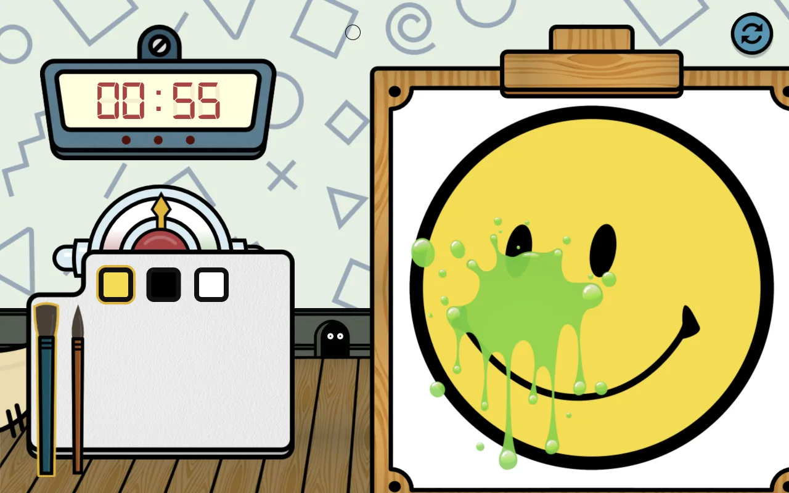

# Repainter — Global Game Jam 2020

A painting game made in 48 hours at Global Game Jam 2020 (theme: "Repair"). Someone has splattered a painting. Pick colours and a brush from the palette and paint it back to the original before the clock runs out. The server compares your painting with the original and scores you on accuracy and speed, with a high score table for each level.



Made by David Neilsen, Rey Benher and Joey Lee.

## How it works

- `server/resources/js/` is the game: an AngularJS app with components for level select, the canvas, the palette and scoring. Some levels throw in "debuffs" partway through, like an enlarged brush or dripping paint.
- `server/app/Http/Controllers/Api/` is a small Laravel 6 API:
  - `LevelController` lists the levels, their colours and time limits.
  - `CompareController` scores a painting. It shrinks your painting and the original, blurs both, and counts how many pixels match within a colour tolerance.
  - `HighScoreController` saves and lists high scores (MySQL).

## Run it locally

It needs PHP 7.2–7.4, Composer and MySQL. Laravel 6 doesn't run on PHP 8.

```sh
cd server
composer install
cp .env.example .env   # set your database details
php artisan key:generate
php artisan migrate
php artisan serve
```

The built front end is already in `server/public/`. To rebuild it, run `npm install && npm run dev` in `server/`.

## Jam brainstorm

The ideas list from the start of the jam:

Ideas:

Doable:

Sysadmin repair
 - console sim
 - apache not working etc
 - hdd full

Painting repair

Tower defense
 - repair own towers?
 - multi player balance attack and defence

Other:

PC repair game
 - physical?
 - board game?

Reverse lemings
 - Instead of destorying terrain, must repair/build it to get to exit

Pipe game
 - repair pipes

Circut board repair
 - have to fix currernts etc
 - could be bomb 

Repair nuclear reactor
 
City repair

Evil AI is repairing itself, must be destroied

Space station repair
 - power failures
 - leaks
 - astroids
 - solar flares
 - aliens

Fluid sim
 - bucket
